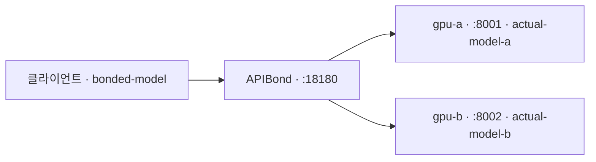

# APIBond · 하나의 모델 이름으로 여러 추론 서버를

[](https://github.com/hikaMaeng/apibond/actions/workflows/ci.yml)
[](https://github.com/hikaMaeng/apibond/releases/latest)
[](LICENSE)

**OpenAI · Anthropic · Responses · Embeddings / 세션 고정 / Rust 스트리밍 중계**

동일 모델을 제공하는 여러 백엔드를 하나의 API 엔드포인트로 묶습니다. 새 세션은 부하를 보고 배정하고, 후속 요청은 같은 서버로 보내 프리픽스 캐시를 재사용할 기회를 유지합니다. 추론 트래픽은 Rust가 처리하며, npm은 설치와 실행을 돕습니다.

[설치](#설치) · [설정](#설정) · [실행](#실행) · [첫 요청](#첫-요청) · [LM Studio](#lm-studio-연결) · [문제 해결](#문제-해결) · [문서](#문서)

## 설치

**Node.js 20 이상**이 있다면 운영체제에 맞는 바이너리를 npm으로 설치합니다. Rust 설치는 필요하지 않습니다.

```sh
npm install -g https://github.com/hikaMaeng/apibond/releases/download/v0.1.1/apibond-0.1.1.tgz
apibond --version
```

현재 npm 설치 경로는 **GitHub Release 패키지 URL**입니다. 처음 실행할 때 바이너리가 다운로드될 수 있습니다.

<details>
<summary><strong>Node 없이 실행하기 — Windows / macOS / Linux 바이너리</strong></summary>

[Releases](https://github.com/hikaMaeng/apibond/releases/tag/v0.1.1)에서 운영체제와 CPU에 맞는 실행 파일을 받습니다.

| 플랫폼 | 다운로드 |
|---|---|
| Windows x64 | [apibond-win32-x64.exe](https://github.com/hikaMaeng/apibond/releases/download/v0.1.1/apibond-win32-x64.exe) |
| macOS Apple Silicon | [apibond-darwin-arm64](https://github.com/hikaMaeng/apibond/releases/download/v0.1.1/apibond-darwin-arm64) |
| macOS Intel | [apibond-darwin-x64](https://github.com/hikaMaeng/apibond/releases/download/v0.1.1/apibond-darwin-x64) |
| Linux x64 | [apibond-linux-x64](https://github.com/hikaMaeng/apibond/releases/download/v0.1.1/apibond-linux-x64) |
| Linux ARM64 | [apibond-linux-arm64](https://github.com/hikaMaeng/apibond/releases/download/v0.1.1/apibond-linux-arm64) |

Windows PowerShell에서는 새 작업 폴더에서 다음과 같이 받습니다.

```powershell
Invoke-WebRequest -Uri "https://github.com/hikaMaeng/apibond/releases/download/v0.1.1/apibond-win32-x64.exe" -OutFile ".\apibond.exe"
.\apibond.exe --version
.\apibond.exe --init
```

macOS Apple Silicon에서는 다음과 같이 받습니다. 다른 플랫폼은 위 표의 다운로드 URL을 사용합니다.

```sh
curl -fL https://github.com/hikaMaeng/apibond/releases/download/v0.1.1/apibond-darwin-arm64 -o apibond
chmod +x ./apibond
./apibond --version
./apibond --init
```

이후 명령의 `apibond`를 Windows에서는 `.\apibond.exe`, macOS/Linux에서는 `./apibond`로 바꿔 실행합니다.

Linux 빌드는 glibc 2.39 이상이 필요합니다. Mac 바이너리의 실행 검증 범위와 서명 정보, 저장소에 포함된 버전별 파일은 [배포 안내](deploy/README.md)를 확인하세요.

</details>

## 설정

### 1. 작업 폴더와 JSON 파일 만들기

npm으로 설치했다면 새 작업 폴더에서 설정 파일을 생성합니다.

```sh
mkdir apibond-demo
cd apibond-demo
apibond --init
```

현재 폴더에 `apibond.json`이 생깁니다. `--init`은 기존 파일을 덮어쓰지 않습니다. 위에서 바이너리로 이미 파일을 만들었다면 해당 폴더에서 다음 단계로 진행합니다.

### 2. 서버 주소와 실제 모델 이름 입력하기

`apibond.json`을 텍스트 편집기로 열고 다음 **전체 설정 예제**를 참고해 수정합니다. 아래 포트와 실제 모델 이름은 예시이므로, 먼저 준비한 추론 서버의 값으로 바꾸세요.

```json
{
  "schema_version": 1,
  "listen": "127.0.0.1:18180",
  "inbound_auth": { "mode": "none" },
  "backends": {
    "gpu-a": {
      "base_url": "http://127.0.0.1:8001/v1",
      "apis": ["openai"],
      "capacity": 10,
      "auth": { "scheme": "none" }
    },
    "gpu-b": {
      "base_url": "http://127.0.0.1:8002/v1",
      "apis": ["openai"],
      "capacity": 10,
      "auth": { "scheme": "none" }
    }
  },
  "models": {
    "bonded-model": {
      "backends": [
        { "backend": "gpu-a", "model": "actual-model-a" },
        { "backend": "gpu-b", "model": "actual-model-b" }
      ]
    }
  }
}
```

이 설정은 두 백엔드의 **Chat Completions API**를 클라이언트 모델 이름 `bonded-model` 하나로 제공합니다.



| 설정 | 입력할 값 |
|---|---|
| `listen` | APIBond가 요청을 받을 주소와 포트 |
| `backends.*.base_url` | 실제 백엔드 API 주소. API 접두사 `/v1`까지 포함 |
| `backends.*.apis` | 해당 백엔드가 실제로 제공하는 API 종류 |
| `backends.*.capacity` | 백엔드당 동시에 중계할 최대 요청 수 |
| `models` 아래의 이름 | 클라이언트가 `model`로 사용할 공개 이름. 예제에서는 `bonded-model` |
| `models.*.backends[].backend` | 위 `backends`에 정의한 이름 |
| `models.*.backends[].model` | 해당 백엔드에 로드된 **실제 모델 ID** |

백엔드의 API 목록에서 실제 모델 ID를 확인하세요. 공개 이름과 실제 모델 이름은 달라도 됩니다. 여러 백엔드의 실제 모델 이름도 서로 다르게 지정할 수 있습니다.

### 3. 사용할 API와 인증 지정하기

백엔드가 추가 API를 제공한다면 `apis`를 확장합니다.

```json
["openai", "anthropic", "responses"]
```

| `apis` 값 | 전달할 API |
|---|---|
| `openai` | OpenAI Chat Completions |
| `anthropic` | Anthropic Messages |
| `responses` | OpenAI Responses |
| `embeddings` | OpenAI Embeddings (unreleased source) |

백엔드마다 지원 목록을 다르게 설정할 수 있습니다. 예를 들어 `anthropic`이 있는 서버만 Messages 요청을 받습니다.

> [!IMPORTANT]
> `apis`는 백엔드의 실제 지원 기능을 선언하는 설정입니다. API 형식 변환은 수행하지 않습니다. 백엔드가 지원하지 않는 경로·콘텐츠 형식은 해당 서버에서 실패할 수 있습니다.

백엔드에 API 키가 필요하면 설정 파일에는 **환경변수 이름**을 지정합니다.

```json
"auth": { "scheme": "bearer", "env": "GPU_A_KEY" }
```

서버를 시작할 터미널에서 해당 변수를 먼저 설정합니다.

```powershell
# Windows PowerShell
$env:GPU_A_KEY = "백엔드에서 발급한 키"
```

```sh
# macOS / Linux
export GPU_A_KEY="백엔드에서 발급한 키"
```

Anthropic 백엔드의 `x-api-key` 인증은 `scheme: "x_api_key"`를 사용합니다. API 종류에 따라 헤더를 선택하려면 `"auto"`를 사용합니다. **클라이언트 → APIBond 인증**은 별도의 `inbound_auth` 설정이며, [인증 설정 예제](docs/usage.md#installation-and-configuration)에 설명합니다.

## 실행

먼저 설정을 검사한 다음, 같은 파일로 서버를 실행합니다.

```sh
apibond --config apibond.json --check
apibond --config apibond.json
```

첫 명령이 성공하면 `Configuration valid: 1 models, 2 backends`가 출력됩니다. 두 번째 명령에서는 `APIBond listening`과 수신 주소가 표시됩니다.

`--check`는 설정과 필요한 환경변수를 검사합니다. 실제 백엔드의 접속·모델 로드 여부는 첫 추론 요청으로 확인합니다. 실행한 터미널은 열어 두고, 종료할 때는 `Ctrl+C`를 누릅니다.

## 첫 요청

**새 터미널을 열고 `apibond.json`이 있는 작업 폴더로 이동**합니다.

### 서버와 공개 모델 확인

```powershell
# Windows PowerShell
curl.exe http://127.0.0.1:18180/healthz
curl.exe http://127.0.0.1:18180/v1/models
```

```sh
# macOS / Linux
curl http://127.0.0.1:18180/healthz
curl http://127.0.0.1:18180/v1/models
```

`/healthz`에서 `"status":"ok"`, `/v1/models`에서 `bonded-model`을 확인합니다. 이 두 응답은 APIBond 자체의 준비 상태를 보여줍니다.

### 실제 모델에 요청 보내기

같은 폴더에 다음 내용을 **UTF-8 형식의 `request.json`**으로 저장합니다.

```json
{
  "model": "bonded-model",
  "messages": [
    { "role": "user", "content": "타입스크립트의 특징을 세 문장으로 설명해줘." }
  ],
  "max_tokens": 4096,
  "stream": true
}
```

```powershell
# Windows PowerShell
curl.exe -N -i http://127.0.0.1:18180/v1/chat/completions -H "Content-Type: application/json" -H "x-apibond-session-id: demo-001" --data-binary "@request.json"
```

```sh
# macOS / Linux
curl -N -i http://127.0.0.1:18180/v1/chat/completions \
  -H "Content-Type: application/json" \
  -H "x-apibond-session-id: demo-001" \
  --data-binary "@request.json"
```

응답의 `x-apibond-backend: gpu-a` 또는 `gpu-b` 헤더에서 선택된 서버를 확인할 수 있습니다. 본문은 백엔드가 보내는 SSE 스트림으로 도착합니다.

**같은 대화에서는 `demo-001`을 유지**하고, 독립된 대화는 `demo-002`처럼 새 ID를 사용합니다. 설정된 TTL 안에서 기존 세션의 서버가 정상일 때 후속 요청은 같은 서버로 갑니다. 운영 상태는 `http://127.0.0.1:18180/status`에서 확인합니다.

### SDK 연결 주소

| 클라이언트 | Base URL | 모델 |
|---|---|---|
| OpenAI Chat Completions | `http://127.0.0.1:18180/v1` | `bonded-model` |
| OpenAI Responses | `http://127.0.0.1:18180/v1` | `bonded-model` |
| Anthropic / Claude Code | `http://127.0.0.1:18180` | `bonded-model` |

해당 API를 지원하는 백엔드를 `apis`에 먼저 지정해야 합니다. **Anthropic 클라이언트의 Base URL에는 `/v1`을 붙이지 않습니다.**

Claude Code가 부모 세션 ID와 에이전트 ID를 보내면 각 에이전트의 대화를 따로 고정합니다. 자세한 헤더 우선순위는 [API 문서](docs/api.md)에 있습니다.

## 단일 노드 임베딩

**현재 소스 빌드에서 지원하며, 공개 v0.1.1 바이너리에는 아직 포함되지 않았습니다.**

`POST /v1/embeddings`는 단일 문자열과 문자열 배열 배치를 지원합니다. `apis: ["embeddings"]`로 실제 임베딩 서버를 지정하고, 기존과 같이 공개 모델 이름을 실제 모델 ID에 연결합니다. 배치 전체가 요청 슬롯 하나를 쓰며, 여러 요청으로 나누거나 벡터를 변환하지 않습니다.

[단일 노드 설정 예제](examples/embeddings-lmstudio.json)는 `192.168.0.6:12345`의 `embeddinggemma2:mp`를 `http://127.0.0.1:18182/v1`의 공개 모델 `embeddinggemma2`로 제공합니다. 소스 빌드·실행 명령과 단건/배치 요청 예제는 [임베딩 사용법](docs/usage.md#single-node-embeddings-unreleased-source)에 있습니다. 실제 입력 형식과 응답 인코딩 지원은 백엔드에 따릅니다.

## LM Studio 연결

같은 LM Studio 서버의 모델 인스턴스 두 개를 묶는 경우, **`base_url`은 같게, 실제 `model`은 서로 다르게** 설정합니다.

이 저장소의 [LM Studio 설정 예제](examples/lmstudio-lan.json)는 다음 구성을 사용합니다.

| 항목 | 값 |
|---|---|
| LM Studio API | `http://127.0.0.1:12345/v1` |
| 백엔드 모델 | `qwen36-35b:28`, `qwen36-35b:tuf` |
| 외부에 제공할 모델 | `qwen36-35b` |
| APIBond 수신 주소 | `0.0.0.0:18180` |
| 백엔드별 동시 중계 상한 | 10개씩 |

체크아웃한 저장소 루트에서 실행합니다.

```sh
apibond --config examples/lmstudio-lan.json --check
apibond --config examples/lmstudio-lan.json
```

LM Studio의 실제 포트·로드된 모델 ID·지원 API에 맞춰 복사본을 수정하세요. 이 예제에서 클라이언트가 사용할 모델 이름은 `bonded-model` 대신 `qwen36-35b`입니다.

LAN에서도 받으려면 `listen`을 `0.0.0.0:18180`로 지정하고, 클라이언트는 `http://<서버의 현재 LAN IP>:18180`에 접속합니다. 수신 설정에 특정 LAN IP를 하드코딩할 필요가 없습니다.

기본 예제는 로컬 개발을 위해 인증이 `none`입니다. LAN 공유 시에는 `inbound_auth`와 방화벽 접근 범위를 함께 설정하세요. 상세 옵션은 [설치·설정 문서](docs/usage.md)를 참고합니다.

## 라우팅과 지원 범위

- **새 세션:** 지원 API가 맞는 백엔드 중 `(active + queue) / capacity`가 낮은 서버를 선택합니다.
- **기존 세션:** 소유 서버를 유지합니다. 다른 서버가 비어도 실행 중 부하를 자동으로 재분산하지 않습니다.
- **Responses·파일 ID:** 생성한 백엔드의 소유권을 추적해 후속 요청을 전달합니다.
- **멀티모달:** 이미지·도구 호출 등이 들어 있는 네이티브 본문을 전달합니다. 실제 해석과 지원 형식은 백엔드에 달려 있습니다.
- **스트리밍:** 백엔드 응답을 스트림으로 중계하며, 느린 수신자와 연결 종료에 따라 요청 슬롯을 관리합니다.

기본 한도는 JSON 요청 64 MiB, 파일 업로드 512 MiB입니다. 이미지 전송·본문 보존 검수와 실모델의 이미지 이해 검수는 구분합니다. 상태 관리·TTL·미지원 프로토콜은 [제약 문서](docs/constraints.md)에 정리했습니다.

## 문제 해결

| 증상 | 확인할 내용 |
|---|---|
| `apibond` 명령을 찾지 못함 | 새 터미널에서 npm 전역 실행 경로를 확인하거나 바이너리를 직접 실행 |
| 설정 파일을 찾지 못함 | 실행한 폴더와 `--config` 경로 확인. 파일은 전역 설치 폴더가 아닌 작업 폴더에 둠 |
| 수신 포트가 이미 사용 중 | `listen`의 포트를 바꾸고 클라이언트 주소도 함께 변경 |
| `502` 또는 백엔드 연결 실패 | 백엔드 프로세스·주소·포트·`/v1` 접두사 확인 |
| `503` | 동시 중계 상한 확인. `capacity`는 대기 큐가 아니며 고정된 서버가 가득 차도 다른 서버로 옮기지 않음 |
| 한 서버만 사용됨 | 같은 대화 ID인지, 독립된 에이전트가 실제로 시작됐는지, 양쪽 `apis`가 요청 API를 지원하는지 확인 |
| 지원하지 않는 콘텐츠·도구 오류 | 백엔드의 해당 API·콘텐츠 형식 지원 확인. APIBond는 누락된 프로토콜 기능을 변환해 보충하지 않음 |

`queue_path`를 설정하지 않았다면 `/status`의 `queued: 0`은 실제 추론 엔진의 대기열이 비어 있다는 뜻이 아닙니다. `available: true`도 모델 로드·추론 성공까지 보장하는 값은 아닙니다.

## 문서

| 목적 | 문서 |
|---|---|
| 개요와 적용 범위 | [Overview](docs/overview.md) |
| 설치·인증·실행 옵션 | [Usage](docs/usage.md) |
| API·헤더·상태 소유권 | [API reference](docs/api.md) |
| 세션 고정·TTL·제약 | [Constraints](docs/constraints.md) |
| 구조와 구현 | [Architecture](docs/architecture.md) · [Internals](docs/internals.md) |
| 빌드·검수 방법 | [Testing](docs/testing.md) |
| 측정 조건과 결과 | [Transport measurements](tests/reports/performance/20261111_154000.md) |
| 실제 다중 에이전트 라우팅 검수 | [Executed workload](tests/reports/claude-agent-affinity/20261112_022605.md) |
| 버전별 바이너리·체크섬 | [Deployments](deploy/README.md) |
| 설계 검토 기록 | [Development plan](docs/development-plan.md) |

## 라이선스

[MIT](LICENSE)
